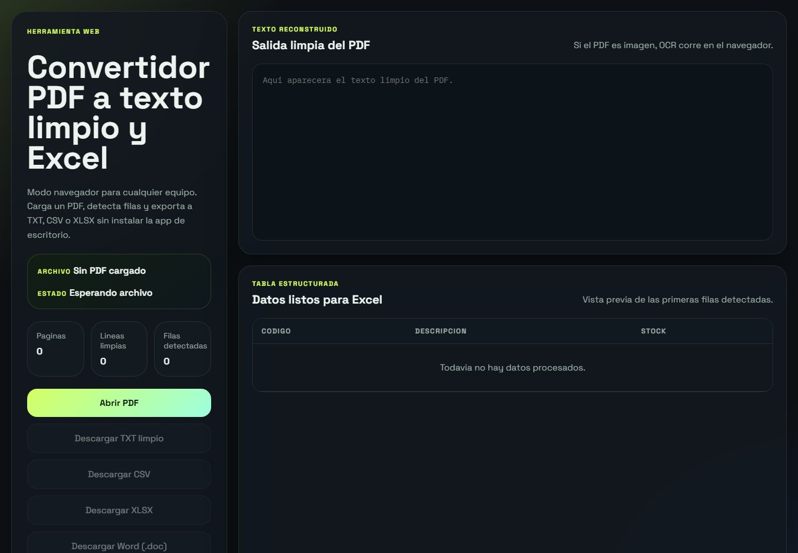

<div align="center">

# Convertidor PDF a Excel

**Pasa el contenido de un PDF a una planilla lista para usar, sin copiar y pegar a mano. Funciona también con PDF escaneados.**


<br>



</div>

> [!NOTE]
> Proyecto personal de **laruzo-dev**: una herramienta de uso general, no desarrollada para un cliente en particular.

## Qué resuelve

Muchos negocios reciben listas de productos, stock o precios en PDF y terminan cargándolas a mano en una planilla. Esta herramienta lee el PDF, limpia el texto, detecta las filas con formato `CÓDIGO - DESCRIPCIÓN - STOCK` y deja los datos listos para abrir en Excel o Word. Si el PDF es una foto o un escaneo, aplica reconocimiento de texto (OCR) en español.

## Funcionalidades

- **Dos modos de lectura**: extracción directa si el PDF tiene texto seleccionable y OCR automático si es una imagen escaneada.
- **Texto limpio**: normaliza las líneas del documento y muestra el resultado antes de exportar.
- **Detección de filas**: reconoce el esquema `CÓDIGO - DESCRIPCIÓN - STOCK` y lo muestra en una tabla de vista previa.
- **Contadores**: páginas, líneas limpias y filas detectadas, con barra de progreso mientras procesa.
- **Exportación a cuatro formatos**: TXT, CSV, XLSX (Excel) y Word (.doc).
- **App de escritorio para Windows**: con instalador y versión portable.
- **Versión web**: funciona en el navegador, sin instalar nada; el OCR corre en el propio navegador.

## Tecnologías

| Parte | Tecnología |
| --- | --- |
| Aplicación de escritorio | Electron |
| Lectura de PDF | pdf.js |
| Reconocimiento de texto (OCR) | tesseract.js (idioma español) |
| Exportación a Excel | SheetJS (xlsx) |
| Interfaz | HTML, CSS y JavaScript |
| Publicación de la versión web | Vercel |

## Para desarrolladores

<details>
<summary><b>Cómo correrlo en tu compu</b></summary>

Requisitos: Windows 10/11 y Node.js 20 o superior (solo para desarrollo y generación de instaladores).

App de escritorio:

```bash
npm install
npm start
```

Versión web:

```bash
npm install
npm run web
```

Se abre en `http://localhost:5173/src/web.html`. No necesita Electron en la compu donde se usa. Para el OCR conviene tener internet la primera vez, para descargar los datos del idioma.

Hay accesos directos para Windows: `INICIAR_DEV.bat` (escritorio) e `INICIAR_WEB.bat` (web).

</details>

<details>
<summary><b>Generar instalador o versión portable</b></summary>

```bash
npm run pack           # carpeta dist/win-unpacked, sin instalador
npm run dist           # instalador NSIS
npm run dist:portable  # ejecutable portable
```

También existe el acceso directo `CREAR_INSTALADOR.bat`. El archivo `spa.traineddata` se incluye en el instalador para que el OCR funcione sin conexión.

</details>

<details>
<summary><b>Cómo funciona</b></summary>

1. El usuario abre un PDF.
2. Se detecta si tiene texto seleccionable.
3. Si no lo tiene, se aplica OCR página por página.
4. Se normalizan las líneas y se detectan las filas estructuradas.
5. Se exporta a TXT, CSV, XLSX o Word.

En la app de escritorio el OCR corre en el proceso principal (Node) y usa `spa.traineddata` local si existe. La versión web usa los archivos de `src/vendor/` (pdf.js, SheetJS y tesseract.js).

</details>

<details>
<summary><b>Estructura del proyecto</b></summary>

- `src/main.js`: proceso principal de Electron, diálogos, guardado y OCR.
- `src/preload.js`: puente seguro entre la interfaz y el proceso principal.
- `src/renderer.js`: interfaz, lectura del PDF, análisis y exportación.
- `src/index.html` y `src/styles.css`: interfaz de escritorio.
- `src/web.html` y `src/web-bridge.js`: versión web.
- `tools/generate-icon.mjs`: genera `build/icon.ico` desde `logo.png`.

</details>

<details>
<summary><b>Despliegue de la versión web en Vercel</b></summary>

El repositorio incluye `vercel.json`, que sirve la carpeta `src` y abre `web.html` en la raíz. En Vercel: importar el repo, preset `Other`, sin comando de build ni carpeta de salida.

</details>

<details>
<summary><b>Problemas frecuentes</b></summary>

- **No abre el selector de archivos**: verificá que estés ejecutando el build actualizado.
- **Error de OCR**: comprobá que `spa.traineddata` esté en la raíz del proyecto o en los recursos del build.
- **El antivirus bloquea el build**: usá `npm run pack` o agregá una exclusión temporal para la carpeta `dist`.

</details>

---

<div align="center">

Diseñado y desarrollado por **[laruzo-dev](https://laruzo-dev-ar.vercel.app)**
<br>
<sub>¿Querés un sistema así para tu negocio? <a href="https://laruzo-dev-ar.vercel.app/#contacto">Hablemos</a>.</sub>

</div>
